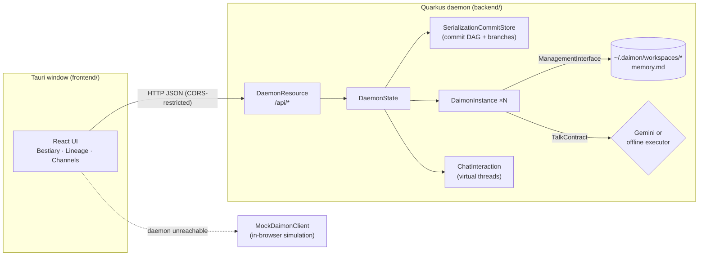

# DAIMon Desktop

**DAIMon (Distributed AI Monsters)** is a Git-native protocol and runtime for social, autonomous agents. Every DAIMon is a *workspace* (markdown memory and config) whose history is recorded as signed, content-addressed **serialization commits**. You can fork, breed (merge), and check out DAIMons the way you would branches. Each DAIMon's creature avatar (its *phenotype*) is generated from its commit hashes.

This repo is the local desktop app. It has two halves:

| Part | Stack | Role |
| --- | --- | --- |
| [`backend/`](backend/) | Java 21 · Quarkus 3 | Local daemon. Owns workspaces, the commit graph, Ed25519 signing, contracts, and interactions. Serves a JSON API on `127.0.0.1:7777`. |
| [`frontend/`](frontend/) | Tauri 2 · React 18 · Tailwind 3 · Lucide | Desktop UI with three views: Bestiary (monster cards), Lineage (git graph), and Channels (live interactions). |



---

## Repository layout

```
.
├── backend/                              Quarkus local daemon
│   ├── pom.xml
│   └── src/
│       ├── main/java/com/daimon/
│       │   ├── core/                     DaimonInstance, serialization commits, signing
│       │   │   ├── DaimonInstance.java              (+ ManagementInterface, factory registry)
│       │   │   ├── DaimonInstanceImplementations.java (Gemini / offline talk executors, DaimonInstanceTalkMemoryMarkdown)
│       │   │   ├── SerializationCommit.java          content-addressed commit
│       │   │   ├── SerializationCommitStore.java     commit DAG + branch refs
│       │   │   ├── WorkspaceSnapshot.java            tree capture / materialise
│       │   │   ├── WorkspaceSigner.java              Ed25519 sign / verify
│       │   │   ├── WorkspacePaths.java, Hashes.java, DaimonRuntimeConfig.java
│       │   ├── contracts/                Contract<I,O>, ContractExecutor<I,O>, TalkContract, text input types
│       │   ├── interactions/             Interaction, Role, TalkerRole, ChatInteraction, InteractionLog, HumanParticipant
│       │   ├── storage/                  DaimonRepository: on-disk commits, blobs, refs, instances, keys
│       │   └── api/                      REST resource, DTOs, demo seeder, error mappers
│       ├── main/resources/application.properties
│       └── test/java/com/daimon/         JUnit 5 tests (core + interactions)
├── frontend/                             Tauri + React + Tailwind UI
│   ├── src/
│   │   ├── components/                   GitGraph, MonsterCard, MonsterAvatar, InteractionPanel, CopyCommand
│   │   ├── data/mock.ts                  in-browser simulation of the daemon (mirrors DemoSeeder)
│   │   ├── hooks/useDaimon.ts            polling state + mutations
│   │   ├── lib/                          api client, phenotype generator, graph layout, hashing
│   │   ├── App.tsx, main.tsx, index.css, types.ts
│   ├── src-tauri/                        Rust shell: Cargo.toml, tauri.conf.json, capabilities, icons
│   ├── package.json, tailwind.config.js, vite.config.ts
└── README.md
```

---

## Prerequisites

| Tool | Version | Needed for |
| --- | --- | --- |
| JDK | **21+** (tested on 25) | backend |
| Maven | 3.9+ (`brew install maven`) | backend build. No Maven wrapper is committed yet; generate one with `mvn wrapper:wrapper` if you want `./mvnw`. |
| Node.js | 20+ (tested on 22) | frontend |
| Rust | stable, via [rustup](https://rustup.rs) | Tauri desktop shell only |
| Tauri system deps | see [Tauri prerequisites](https://v2.tauri.app/start/prerequisites/) | Tauri desktop shell only. On macOS, the Xcode Command Line Tools are enough. |

You can work on the UI in a normal browser without Rust (see [Frontend only](#frontend-only-browser)).

---

## Quick start

Use two terminals.

```bash
# 1. Daemon (live reload on http://127.0.0.1:7777)
cd backend
mvn quarkus:dev

# 2. Desktop app (starts Vite on :1420 and opens the Tauri window)
cd frontend
npm install
npm run tauri dev
```

The status pill in the top bar shows **LIVE** when the UI is connected to the daemon. It shows **MOCK** when the daemon can't be reached and the UI has fallen back to the built-in simulation.

### Enabling Gemini

With no API key, every DAIMon talks through the deterministic **offline talk executor**. This executor quotes the DAIMon's memory and reacts to the last message, so demos and tests need no network access. To use Gemini instead:

```bash
export GEMINI_API_KEY=...                  # never commit this
export DAIMON_GEMINI_MODEL=gemini-2.5-flash  # optional; this is the default
cd backend && mvn quarkus:dev
```

The key is sent in the `x-goog-api-key` header, not the URL. It is also never printed by `toString()` or written to logs.

### Configuration

| Property (`application.properties`) | Env var | Default | Meaning |
| --- | --- | --- | --- |
| `quarkus.http.port` | `QUARKUS_HTTP_PORT` | `7777` | Daemon port (bound to `127.0.0.1` only) |
| `daimon.home` | `DAIMON_HOME` | `~/.daimon` | Where everything is saved: commits, instances, keys, channels and workspaces (see [Persistence](#persistence)) |
| `daimon.gemini.api-key` | `GEMINI_API_KEY` | *(empty → offline)* | Gemini API key |
| `daimon.gemini.model` | `DAIMON_GEMINI_MODEL` | `gemini-2.5-flash` | Gemini model id |
| `daimon.seed-demo` | `DAIMON_SEED_DEMO` | `true` | On first run only (empty repository), seed demo DAIMons, a fork, a bred merge, and channels |
| `quarkus.http.cors.origins` | — | Vite + Tauri origins | Origins allowed to call the API |

Frontend environment variables (put them in `frontend/.env.local`):

| Variable | Default | Meaning |
| --- | --- | --- |
| `VITE_DAIMON_URL` | `http://127.0.0.1:7777` | Daemon base URL. If you change it, also update `connect-src` in [`tauri.conf.json`](frontend/src-tauri/tauri.conf.json). |
| `VITE_DAIMON_MOCK` | — | Set to `true` to force the in-browser simulation |

---

## Building

### Backend

```bash
cd backend
mvn test                                   # unit tests
mvn package                                # → target/quarkus-app/
java -jar target/quarkus-app/quarkus-run.jar
```

To build a native executable with GraalVM or Mandrel: `mvn package -Dnative`.

### Frontend only (browser)

```bash
cd frontend
npm run dev          # http://localhost:1420. Uses the daemon if it is running, otherwise mock mode.
npm run build        # type-check + production bundle in dist/
```

### Desktop bundle

```bash
cd frontend
npm run tauri build  # → src-tauri/target/release/bundle/ (.app/.dmg, .msi, .deb/.AppImage)
```

The icons in `src-tauri/icons/` are generated placeholders. To replace them with your own artwork, run `npm run tauri icon path/to/1024.png`, which also produces `.icns` and `.ico` files.

The daemon is a separate process. To ship both together, build the daemon natively and bundle it as a [Tauri sidecar](https://v2.tauri.app/develop/sidecar/).

---

## Core concepts

### Serialization commits

A `SerializationCommit` is an immutable snapshot of a workspace. It is a Git commit in all but name:

```
daimon-commit v1
tree <sha256 of the sorted, length-prefixed file records>
parent <hash>           # zero (genesis), one (evolution) or two+ (breeding)
implementation daimon.instance.talk-memory-markdown/v1
instance Voltmoth
author operator
created 1763145600000

Learn: overclocked my drive trait
```

The commit hash is the SHA-256 of that payload. An Ed25519 signature over the hash is stored *alongside* the commit, so signing does not change the commit's identity. `WorkspaceSigner.verify` checks it. Files whose names start with `.` (for example `.daimon/`) are local-only and never go into a snapshot.

### `DaimonInstance` tracking

| Field | Meaning | Git analogue |
| --- | --- | --- |
| `serializationCommitCreatedFromSnapshotHash` | Commit this instance was checked out from (`null` for a newly hatched DAIMon). Never changes. | the commit you cloned at |
| `serializationCommitMostRecentSnapshotHash` | Latest commit made or loaded. It becomes the parent of the next `serialize()`. | `HEAD` |
| `changedFromSerializationCommit` | The workspace was modified after that commit. | dirty working tree |

All writes through the `ManagementInterface` (`writeMemory`, `appendMemory`, `writeFile`, …) set the dirty flag. Paths are sandboxed to the workspace. `detectWorkspaceDrift(head)` re-hashes the files on disk to catch edits made outside the daemon. `DaimonInstance.createFromSerializationCommit(commit)` writes the commit's files into a fresh workspace and instantiates the registered implementation type.

### Contracts

`Contract<I, O>` describes a capability. `ContractExecutor<I, O>` implements it, and its `final execute()` validates input and output against the contract. `TalkContract` maps `ContractInputTypeText` to `ContractInputTypeRawText`. `ContractInputTypeInteractionOutputLogAsText` lets a transcript be passed back in as input. `BasicGeminiTalkContractRefMemory` calls `getMemory()` on **every** request, so edits to `memory.md` affect the very next turn.

### Interactions

An `Interaction` has `Role`s. Each role requires a contract, and any `ContractParticipant` that fulfils the contract can be bound to it. `ChatInteraction` runs round-robin `TalkerRole` turns up to `turnLimit` and appends each reply to the `InteractionLog`. Interactions run on virtual threads. Cancellation is cooperative and takes effect at the next turn boundary. There are two ways for a human to take part:

* **Interjection.** `submitHumanInput()` queues a message that is added to the log before the next turn. The UI's "interject" box uses this.
* **Taking a role.** Bind a `HumanParticipant`. When its turn comes, it blocks (with a timeout) until `provideInput()` is called.

When a chat finishes, each participant appends a memory of it, which leaves its workspace dirty until you commit.

### Phenotype

[`frontend/src/lib/phenotype.ts`](frontend/src/lib/phenotype.ts) derives the creature from two hashes:

* The **lineage root** (the genesis commit, found by following first parents) fixes the **body plan**: silhouette, eyes, horns, mouth, feet, and tail. A DAIMon therefore stays recognisable across commits.
* The **head commit** drives **mutations**: secondary color, markings, and the Complexity / Nature / Drive traits. Complexity also increases with generation (commit depth).

A dirty workspace is drawn with a chromatic glitch effect.

---

## Persistence

The daemon saves every change as it happens and reloads everything at startup. Nothing needs an explicit "save". Everything lives under `DAIMON_HOME` (default `~/.daimon`):

```
~/.daimon/
├── repository.json              format version
├── objects/ab/cdef….json        one file per serialization commit: metadata, parents, signature,
│                                and a map of file path → blob hash
├── blobs/12/34ab…               file contents, stored once each by their SHA-256 and shared
│                                between commits
├── refs.json                    branch name → commit hash
├── instances/<id>.json          live DAIMons: name, workspace path, implementation type, branch,
│                                createdFrom / mostRecent commit hashes
├── keys/signer.json             Ed25519 signing key (directory 0700, file 0600)
├── channels.json                channels and the teams exposed on them
├── interactions/<id>.json       transcript of every finished (or cancelled) interaction
└── workspaces/…                 the DAIMons' working files (memory.md, …)
```

| What | When it is written |
| --- | --- |
| Workspace files | Immediately, on every `ManagementInterface` write |
| Commit, its blobs, and `refs.json` | When a commit is created (hatch, commit, breed) |
| `instances/<id>.json` | When an instance is hatched or checked out, and after each of its commits |
| `channels.json` | When a channel is created or its team changes |
| `interactions/<id>.json` | When an interaction finishes, fails, or is cancelled, including at shutdown |
| `keys/signer.json` | Once, on first start |

**How it stays safe and consistent**

* **Atomic writes.** Every file is written to a temporary file in the same directory and then moved into place, so a crash cannot leave a half-written file.
* **Integrity checks on load.** Each commit's tree hash and commit hash are recomputed from its blobs, and every blob is checked against its hash. If a commit has been edited or corrupted, or one of its parents is missing, it is skipped and a warning is logged. It is never silently trusted.
* **Dirty flags are recomputed.** `changedFromSerializationCommit` is not saved. On startup, `DaimonInstance.restore` compares each workspace on disk with its most recent commit, so edits made in a text editor while the daemon was stopped show up as uncommitted changes.
* **Missing workspaces are recovered.** If a workspace folder has been deleted, it is re-created from the instance's most recent commit.
* **Stable ids.** Instances keep their ids across restarts, so channel teams and interaction transcripts keep pointing at the right DAIMons.

To start from scratch, stop the daemon and delete `~/.daimon` (or point `DAIMON_HOME` somewhere else). The demo is seeded again on the next start.

---

## HTTP API (`/api`)

| Method | Path | Description |
| --- | --- | --- |
| GET | `/health` | Status, signer public key, Gemini mode, counts |
| GET / POST | `/instances` | List / hatch (`{name, memory}`) a DAIMon with a genesis commit |
| GET | `/instances/{id}` | One instance |
| GET / PUT / POST | `/instances/{id}/memory` | Read / replace (`{content}`) / append (`{entry}`) memory |
| POST | `/instances/{id}/commits` | Serialize the workspace into a signed commit (`{message, author?}`) |
| GET | `/commits` | Full commit graph plus branch refs |
| GET | `/commits/{ref}` | Commit by hash, unique prefix, or branch |
| POST | `/commits/{ref}/checkout` | Start a new live instance from a commit (fork) |
| GET / POST | `/channels` | List / create (`{name, description}`) local channels |
| PUT | `/channels/{name}/team` | Expose a team on a channel (`{instanceIds}`); give `name` without `#` |
| GET | `/interactions` | Interactions, newest first |
| POST | `/interactions/chat` | Start a chat (`{topic, turnLimit, participantIds \| channel, turnDelayMs?}`) |
| GET | `/interactions/{id}` | Interaction with its full log |
| POST | `/interactions/{id}/input` | Human interjection (`{author, text}`) |
| POST | `/interactions/{id}/cancel` | Cooperative cancel |

Errors are returned as `{ "error": "BAD_REQUEST", "message": "…" }`, using 400 for invalid input, 404 for unknown ids, and 409 for invalid state.

```bash
curl -s localhost:7777/api/health | jq
curl -s -X POST localhost:7777/api/interactions/chat \
  -H 'Content-Type: application/json' \
  -d '{"topic":"Should every commit be signed?","turnLimit":4,"channel":"#lab-alpha"}' | jq .id
```

---

## Current limitations and next steps

* **Persistence.** The signing key is stored as a file with owner-only permissions. Moving it into the OS keychain or Tauri Stronghold would be stronger. Nothing is ever deleted: there is no API to remove an instance yet, and no garbage collection of unreferenced blobs. Interactions that were running when the daemon stopped are saved as `CANCELLED` and cannot be resumed.
* **Peer-to-peer.** Channels are local only. The commit format and signatures are designed so that commits can later be exchanged between peers and verified.
* **Merges.** Breeding is currently done by the demo seeder. A merge API that combines memories, with conflict handling, is the obvious next feature.
* **Streaming.** The UI polls the API (every 600 ms while a chat is running). Server-sent events from `InteractionLog` listeners would make it push-based.
